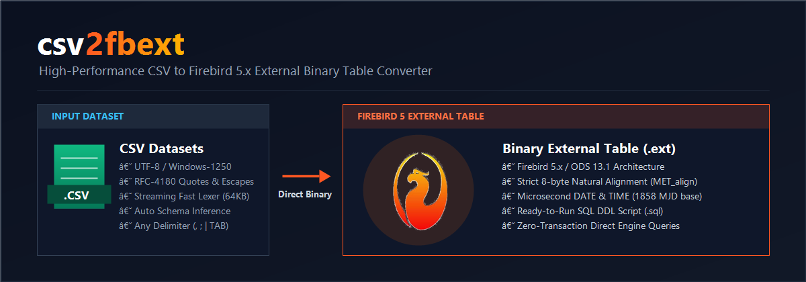
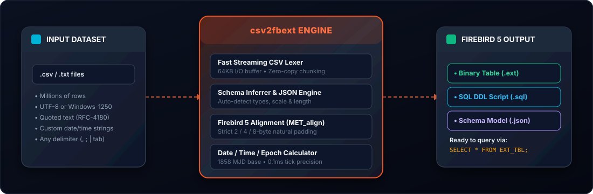
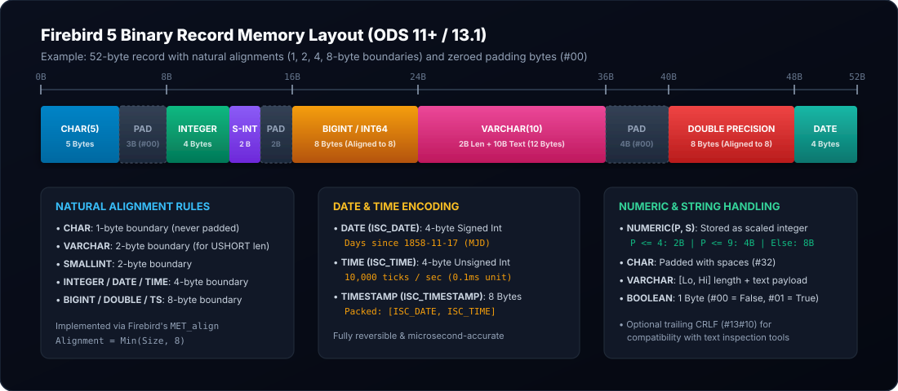

# csv2fbext
### High-Performance CSV to Firebird 5 External Table Converter

<p align="center">
  
</p>

<p align="center">
  <a href="https://www.embarcadero.com/products/delphi"></a>
  <a href="https://firebirdsql.org"></a>
  
  
</p>

---

## Overview

**`csv2fbext`** is a standalone, cross-platform CLI tool engineered in **Delphi 11** to transform massive CSV (Comma/Semicolon Separated Values) datasets into native **Firebird 5 external binary table files (`.ext`)** with maximum throughput via direct binary streaming.

Firebird external tables bypass the standard transactional database insertion pipeline, allowing the database engine to directly read structured, fixed-offset binary records from disk like a native table.

<p align="center">
  
</p>

---

## Key Highlights

- **Full Firebird 5 Type Support:** Unlike primitive tools that only output character text blocks, `csv2fbext` encodes all Firebird native binary types: `CHAR`, `VARCHAR`, `SMALLINT`, `INTEGER`, `BIGINT`, `FLOAT`, `DOUBLE PRECISION`, `BOOLEAN`, `DATE`, `TIME`, `TIMESTAMP`, `NUMERIC`, and `DECIMAL`.
- **Accurate Alignment (ODS 11+ / Firebird 5):** Replicates Firebird's internal alignment rules (`MET_align`):
  - `CHAR`: 1-byte boundary (unpadded).
  - `VARCHAR`: 2-byte aligned length prefix (`Word`), followed by a fixed character payload.
  - `SMALLINT`, `INTEGER`, `BIGINT`, `FLOAT`, `DOUBLE`: 2, 4, and 8-byte natural boundaries.
- **Precision Date and Time Engine:**
  - Firebird Modified Julian Date Epoch (November 17, 1858) handling.
  - Native `TIME` fractional second calculation (10,000 ticks/sec, 0.1 ms precision).
  - Native `TIMESTAMP` composition (4-byte Date + 4-byte Time).
  - Flexible multi-format input parsing (ISO-8601, European, Hungarian `yyyy.mm.dd.`, custom formats).
- **Zero-Dependency Linux and Windows Encoding:** Built-in self-contained Windows-1250 (ANSI) and UTF-8 codecs that execute natively without operating system code page dependencies on Linux headless servers.
- **Automated Schema Inference:** Inspects unknown CSV files, predicts column types, scale, precision, and max lengths, and generates ready-to-run JSON schema definitions and SQL DDL scripts.
- **Built-in Self-Testing Suite:** Includes 45 automated unit tests validating boundary alignments, date/time offsets, numerical scaling, and end-to-end file parity.

---

## Firebird 5 Binary Record Layout

Firebird external table records are raw, uncompressed structs. If alignment rules are not strictly followed, queries against the external table will return corrupted or shifted data.

<p align="center">
  
</p>

### Type Mapping and Alignment Matrix

| Firebird Type | Delphi Equivalent | Field Size | Alignment Boundary | Firebird Binary Representation |
| :--- | :--- | :--- | :--- | :--- |
| `CHAR(N)` | `string` / `AnsiString` | N bytes | **1 byte** | Text padded with spaces (`#32`) |
| `VARCHAR(N)`| `string` / `AnsiString` | 2 + N bytes | **2 bytes** | 2-byte `Word` length prefix + text |
| `SMALLINT` | `SmallInt` (16-bit) | 2 bytes | **2 bytes** | Little-endian signed 16-bit integer |
| `INTEGER` | `Integer` (32-bit) | 4 bytes | **4 bytes** | Little-endian signed 32-bit integer |
| `BIGINT` | `Int64` (64-bit) | 8 bytes | **8 bytes** | Little-endian signed 64-bit integer |
| `FLOAT` | `Single` (32-bit) | 4 bytes | **4 bytes** | IEEE 754 single precision float |
| `DOUBLE` | `Double` (64-bit) | 8 bytes | **8 bytes** | IEEE 754 double precision float |
| `BOOLEAN` | `Boolean` (8-bit) | 1 byte | **1 byte** | `0` (False) or `1` (True) |
| `DATE` | `Integer` (`ISC_DATE`) | 4 bytes | **4 bytes** | Days elapsed since `1858-11-17` |
| `TIME` | `Cardinal` (`ISC_TIME`)| 4 bytes | **4 bytes** | Ticks since midnight (1 tick = 100 microseconds) |
| `TIMESTAMP` | `TFBTimestamp` | 8 bytes | **8 bytes** | 4-byte `ISC_DATE` + 4-byte `ISC_TIME` |
| `NUMERIC(P,S)`| `SmallInt` / `Integer` / `Int64` | 2, 4, or 8 B | **2, 4, or 8 B** | Scaled integer: Value * 10^S |

---

## Date and Time Architecture

### 1. The Firebird Epoch
Firebird stores dates as **Modified Julian Day numbers (MJD)** relative to **November 17, 1858**.
```
FB_Date = Trunc(Delphi_Date) + 15018
```

### 2. Time Precision
Firebird 5 stores time as an unsigned 32-bit integer representing fractions of a second:
- **Precision:** 1 tick = 1/10,000 second (0.1 ms).
- **Day span:** 0 to 863,999,999 ticks (24 * 3600 * 10,000).

```
FB_Time = (Hour * 3600 + Minute * 60 + Second) * 10000 + (Millisecond * 10)
```

---

## Table Schema Specification (`schema.json`)

To describe your target table structure, create a JSON schema file:

```json
{
  "tableName": "EXT_INVOICES",
  "externalFileName": "invoices.ext",
  "characterSet": "WIN1250",
  "delimiter": ";",
  "quoteChar": "\"",
  "hasHeader": true,
  "includeCRLF": false,
  "dateFormat": "yyyy-mm-dd",
  "timeFormat": "hh:nn:ss",
  "timestampFormat": "yyyy-mm-dd hh:nn:ss",
  "decimalSeparator": ",",
  "columns": [
    {
      "name": "ID",
      "type": "INTEGER"
    },
    {
      "name": "CUSTOMER_NAME",
      "type": "VARCHAR",
      "length": 60,
      "trimSpaces": true
    },
    {
      "name": "NET_AMOUNT",
      "type": "NUMERIC",
      "precision": 15,
      "scale": 2,
      "decimalSeparator": ","
    },
    {
      "name": "IS_PAID",
      "type": "BOOLEAN"
    },
    {
      "name": "INVOICE_DATE",
      "type": "DATE",
      "dateFormat": "yyyy.mm.dd."
    },
    {
      "name": "CREATED_AT",
      "type": "TIMESTAMP",
      "timestampFormat": "yyyy-mm-dd hh:nn:ss"
    }
  ]
}
```

---

## CLI Usage

```
Usage:
  csv2fbext <command> [options]

Commands:
  convert    Convert CSV file to Firebird 5 external binary table (.ext)
  infer      Inspect CSV file and generate JSON schema & SQL DDL
  test       Run built-in test suite verifying all Firebird 5 types

Convert Options:
  -i, --input <file>        Input CSV file path (required)
  -o, --output <file>       Output .ext file path (default: <csv_name>.ext)
  -s, --schema <file>       JSON schema file path
  -t, --table <name>        Table name (default: EXT_<csv_name>)
  --sql <file>              Output SQL CREATE TABLE DDL script
  -d, --delimiter <char>    CSV delimiter character (default: ";")
  -q, --quote <char>        CSV quote character (default: '"')
  -c, --charset <name>      Character set (default: "WIN1250")
  --no-header               CSV has no header row
  --crlf                    Append CRLF (#13#10) to each external record
  --legacy-str <file>       Import old .str file from pb project

Infer Options:
  -i, --input <file>        Input CSV file path (required)
  -s, --schema <file>       Output JSON schema file path
  --sql <file>              Output SQL CREATE TABLE script path
  -t, --table <name>        Table name
  --sample <n>              Max sample rows (default: 50000)

Quick syntax:
  csv2fbext <input.csv> [output.ext] [tablename] [schema.json]
```

### Examples

#### 1. Infer Schema and Generate DDL from CSV
```powershell
csv2fbext infer -i invoices.csv -s invoices.json --sql invoices.sql
```

#### 2. Convert CSV with a Custom Schema
```powershell
csv2fbext convert -i invoices.csv -s invoices.json -o invoices.ext --sql invoices.sql
```

#### 3. Quick One-Line Conversion (Auto-inference)
```powershell
csv2fbext customers.csv customers.ext EXT_CUSTOMERS
```

#### 4. Run Built-In Self-Tests
```powershell
csv2fbext test
```

---

## Querying in Firebird 5

Once `csv2fbext` produces the `.ext` file and `.sql` script:

1. **Configure Firebird Access:**  
   In your `firebird.conf`, ensure external table access is enabled:
   ```ini
   ExternalFileAccess = Restrict /path/to/external/files
   ```

2. **Execute the Generated DDL:**
   ```sql
   CREATE TABLE EXT_INVOICES EXTERNAL 'invoices.ext' (
     ID                   INTEGER,
     CUSTOMER_NAME        VARCHAR(60) CHARACTER SET WIN1250,
     NET_AMOUNT           NUMERIC(15, 2),
     IS_PAID              BOOLEAN,
     INVOICE_DATE         DATE,
     CREATED_AT           TIMESTAMP
   );
   ```

3. **Query Directly with Standard SQL:**
   ```sql
   SELECT 
       ID, 
       CUSTOMER_NAME, 
       NET_AMOUNT, 
       INVOICE_DATE 
   FROM EXT_INVOICES 
   WHERE INVOICE_DATE >= '2026-01-01'
   ORDER BY ID;
   ```

4. **Transfer into an Internal Production Table:**
   ```sql
   INSERT INTO PRODUCTION_INVOICES (ID, CUSTOMER_NAME, NET_AMOUNT, INVOICE_DATE)
   SELECT ID, CUSTOMER_NAME, NET_AMOUNT, INVOICE_DATE FROM EXT_INVOICES;
   ```

---

## Building from Source

### Prerequisites
- **Embarcadero Delphi 11 Alexandria** (or newer)
- Command-line compilers: `dcc64` (Windows 64-bit), `dcc32` (Windows 32-bit), or `dcclinux64` (Linux 64-bit)

### Windows 64-bit Build
```powershell
dcc64 -B -Q -Isrc -Usrc csv2fbext.dpr
```

### Windows 32-bit Build
```powershell
dcc32 -B -Q -Isrc -Usrc csv2fbext.dpr
```

### Linux 64-bit Build (Cross-compile via PAServer or Docker)
```bash
dcclinux64 -B -Q -Isrc -Usrc csv2fbext.dpr
```

